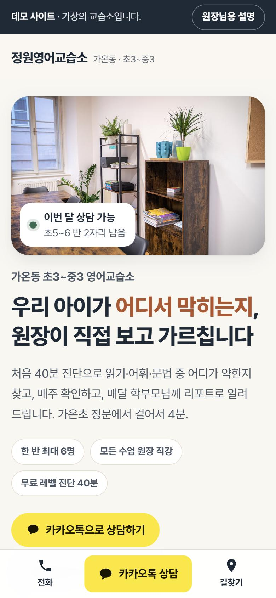
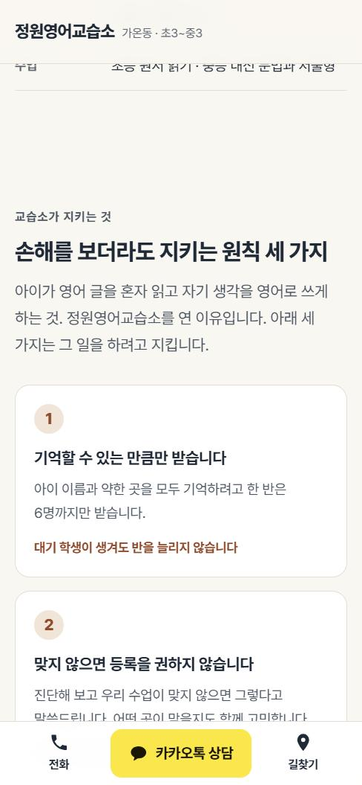
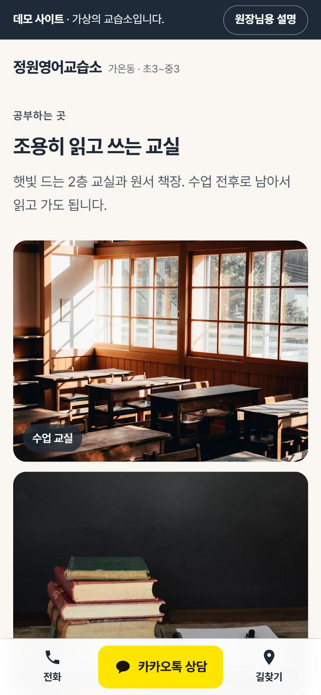
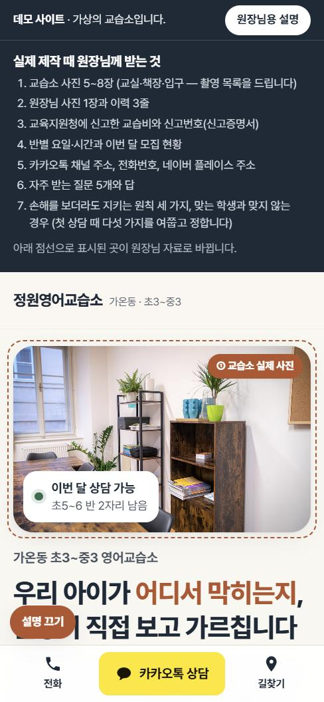
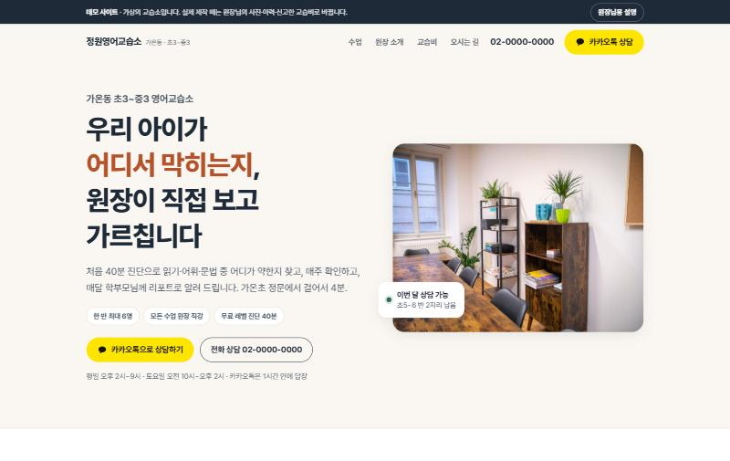

# 정원영어교습소 — 교습소 홈페이지 데모

교습소·소규모 학원용 홈페이지가 어떤 모습인지 보여 드리는 시연용 사이트입니다.
'정원영어교습소'는 가상 업체입니다. 상호·인물·주소·전화·교습비·신고번호는 실제가 아닙니다.

- 데모 보기: https://leeyou34.github.io/kyoseupso-demo/
- '원장님용 설명'을 켠 채로 보기: https://leeyou34.github.io/kyoseupso-demo/#owner — 실제 제작 때 원장님 자료(사진·이력·교습비 등)로 바뀌는 자리를 점선으로 보여 줍니다.

## 담은 것
- 모바일 우선 한 장 구성: 첫 화면(지역·학년·과목) → 한눈에 보기 → 가르치는 방식 → 원장 소개 → 교습소가 지키는 원칙과 맞는 학생 → 학년별 수업과 학교별 시험 일정 → 수업 한 주와 월간 리포트 → 수업 사례 → 교실 → 교습비·모집 현황 → 상담부터 첫 수업까지 → 자주 묻는 질문 → 오시는 길 → 상담 신청·소식
- 교습소의 목적과 원칙 세 가지, 이런 아이에게 맞고 이런 경우엔 다른 곳이 나을 수 있다는 안내. 맞는 학생이 찾아오게 하려는 장치입니다. 실제 제작 때는 원장님 인터뷰로 채웁니다
- 월간 리포트는 이번 달 목표 · 지금 어디쯤 · 다음 달 할 일 세 줄로 씁니다
- 한눈에 보기: 대상 · 정원 · 수업 시간 · 교습비 · 첫 상담 · 위치를 한 표에 두고 마지막 수정일을 적습니다
- 학교별 시험 일정, 체험 수업 1회, 동의받은 수업 사례(결과는 학생마다 다르다는 문장과 함께), 블로그 최근 글
- 연락: 카카오톡 상담 · 전화 · 길찾기(모바일 화면 아래 고정)
- 교습비와 교습소 표시 사항(명칭 · 교습과목 · 신고번호) — 「학원의 설립·운영 및 과외교습에 관한 법률」 제15조 표시 기준
- 개인정보: 보호자 연락처와 학년만 받고, 수집·이용 안내 후 동의 1개
- 지어낸 후기 없음 — 네이버 플레이스 방문자 리뷰로 연결
- 검색 노출 막음(noindex) — 시연용이므로

## 점검 (2026-11-12)
- 접근성 자동 점검: axe-core 4.10.2, WCAG 2.0·2.1·2.2 A/AA 규칙 — 위반 0건(모바일 390px · 데스크톱 1440px)
- 레이아웃 흔들림(CLS) 0 · 가로 넘침 없음(390 · 820 · 1440px)
- 외부 스크립트 0개(글꼴 CSS와 사진만 외부에서 불러옴)

## 참고한 곳 (2026-11-12)
구조와 기능만 참고했고 디자인·문구는 가져오지 않았습니다.
- [Ancourage Academy](https://ancourage.academy/) (싱가포르): 한눈에 보는 요약표, 기존 반 수업에 들어가 보는 체험 수업, '결과는 학생마다 다르다'를 붙인 수업 사례
- [안창모 특목수능 영어학원](https://learneng-mo.imweb.me/) (부산): 학교별 시험 분석 글과 소식 목록
- [11talk](https://11talk.net/): 레벨 테스트 → 맛보기 수업 → 등록으로 이어지는 단계 안내
- [당근 동네업체 프로필 예](https://daangn.com/kr/local-profile/%EC%A4%84%EB%A6%AC%EB%9E%91%EC%98%81%EC%96%B4-zzipqu98p845/): 무료 레벨테스트·체험 수업 안내, 소식 글, 마지막 수정일 표시

## 사진 (Unsplash License, 무료)
- Timur Shakerzianov — 나무 책상과 책장이 있는 작은 방
- Unseen Studio — 나무 책상에서 공책에 글을 쓰는 손
- SAE SOL — 흰 책상과 분홍 의자가 놓인 밝은 교실
- Thomas Bormans — 영어 원서가 꽂힌 책장

## 파일
- `index.html` — 한 장짜리 홈페이지
- `docs/screenshots/` — 화면

만든 곳: 더엔에스홀딩스(주) AX 솔루션 사업본부
