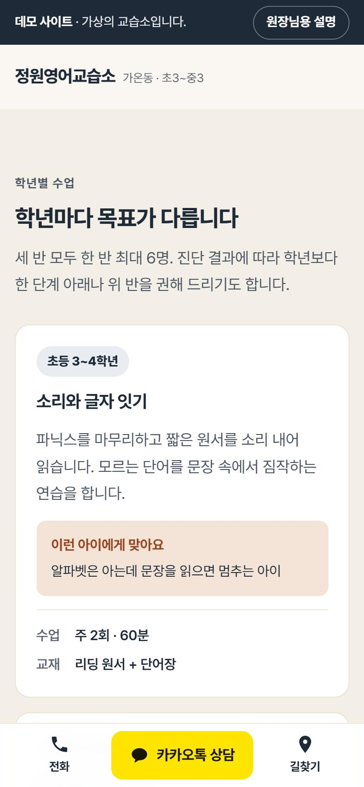
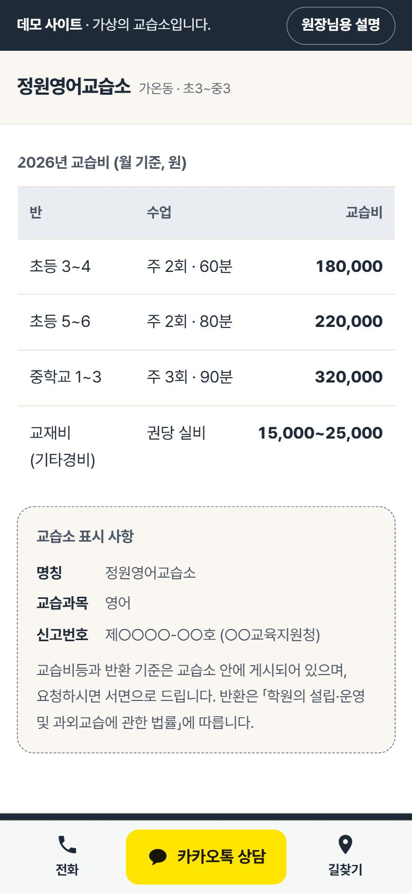

# 교습소 홈페이지 데모 (v2)

더엔에스홀딩스(주) AX 솔루션 사업본부가 1~5인 교습소·학원용 홈페이지 상품(H-003)을 원장님께 보여 드리려고 만든 데모입니다.
'정원영어교습소'는 가상 업체입니다. 상호·인물·주소·전화·교습비·신고번호는 실제가 아닙니다.

| 모바일 첫 화면 | 수업 | 교습비·법정 표시 | 원장님용 설명 켠 화면 |
|---|---|---|---|
|  |  |  |  |

스크린숏은 실제 사진·글꼴을 불러온 브라우저 화면입니다(2026-11-09 22:56~23:07, 모바일 390×844 · 데스크톱 1440×900).

## v1 → v2에서 바뀐 것

| 항목 | v1 | v2 |
|---|---|---|
| 사진 | 0장 ('사진 자리' 회색 상자) | 4장(무료 라이선스). 실제 제작 땐 교습소 사진으로 교체 |
| 연락 경로 | 레벨 테스트 신청서 하나 | 카카오톡 1순위 · 전화 2순위 · 신청서 3순위. 모바일 하단 고정 바 |
| 후기 | '예시 후기' 3개 (가짜) | 없앰. 네이버 플레이스 방문자 리뷰로 연결 |
| '예시' 표시 | 블록마다 배지 | 맨 위 안내 1줄 + '원장님용 설명' 버튼(바뀔 자리를 점선으로 표시) |
| 법정 표시 | 교습비 표만 | 교습소 명칭·교습과목·신고번호·교습비·기타경비·반환 안내 |
| 개인정보 | 학생 이름까지 수집 | 보호자 연락처·학년만. 수집·이용 4개 항목 안내 + 동의 1개 |
| 위치 | 주소 글자만 | 약도 + 네이버 지도·카카오맵 길찾기 |
| 상담 뒤 흐름 | 없음 | 문의 → 진단 → 결과 상담 → 첫 수업 → 매달 리포트 |
| 검색 | 없음 | 제목·설명·구조화 데이터(JSON-LD) 예시. 데모라 검색 노출 막음(noindex) |
| 글꼴 | Gowun Dodum + IBM Plex Sans KR | Pretendard(필요한 글자만 내려받는 방식), 본문 17px·줄간격 1.7 |

## 보는 방법
비공개 저장소입니다. `index.html`을 내려받아 브라우저로 여세요(사진·글꼴은 인터넷에서 불러옵니다).
주소 끝에 `#owner`를 붙여 열면 '원장님용 설명'이 켜진 상태로 열립니다.
비교용 v1은 `v1/index.html`에 있습니다.

## 점검 결과 (2026-11-09, 자동 점검)
- 접근성: axe-core 4.10.2, WCAG 2.0/2.1/2.2 A·AA 규칙 — 위반 0건 (모바일 390px·데스크톱 1440px). 사진 위 글자 등 자동 판정 못 한 대비 7곳은 수동 계산으로 4.5:1 이상 확인
- 레이아웃 흔들림(CLS): 0 (실험실 측정)
- 가로 넘침: 390·820·1440px 모두 없음
- 키보드: 첫 Tab에 '본문으로 건너뛰기'. 카카오톡 미리보기는 브라우저 기본 대화상자(Esc로 닫힘, 포커스 가둠)
- 실제 사용자 속도(LCP·INP 75번째 백분위)는 공개 배포 뒤에만 잴 수 있음 — 아직 미측정

## 실제 제작 때 원장님께 받는 것
교습소 사진 5~8장 · 원장 사진 1장과 이력 3줄 · 교육지원청에 신고한 교습비와 신고번호 · 반별 시간과 모집 현황 · 카카오톡 채널·전화·네이버 플레이스 주소 · 자주 받는 질문 5개

## 사진 출처 (Unsplash License, 무료)
- Timur Shakerzianov — 나무 책상과 책장이 있는 작은 방 (photo-1676223303556-bef6fdac9331)
- Karolina Grabowska — 스탠드와 책이 놓인 수납장 (photo-1667312939978-64cf31718a6e)
- Ü Lõ — 책장 가득한 책 (photo-1771172193679-cce75ed26588)
- Ioann-Mark Kuznietsov — 창가에 펼친 책 (photo-1495640452828-3df6795cf69b)

## 파일
- `index.html` — v2 한 장짜리 홈페이지 (외부 요청: Pretendard 글꼴 CDN, Unsplash 이미지)
- `v1/index.html` — 재설계 전 원본
- `docs/screenshots/` — 위 화면

## 버전
- v1 `eb49b24` (2026-11-09) — 처음 만든 데모. 본부장 검토에서 "이 품질로는 고객이 홈페이지를 사지 않는다" 판정
- v2 (2026-11-09) — ChatGPT·Grok·Perplexity·Gemini 2차례 토론, 법령·표준 원문 확인 뒤 다시 만든 것. 근거는 사내 보고서 `261109-04_교습소사이트_재설계_보고서.docx`
